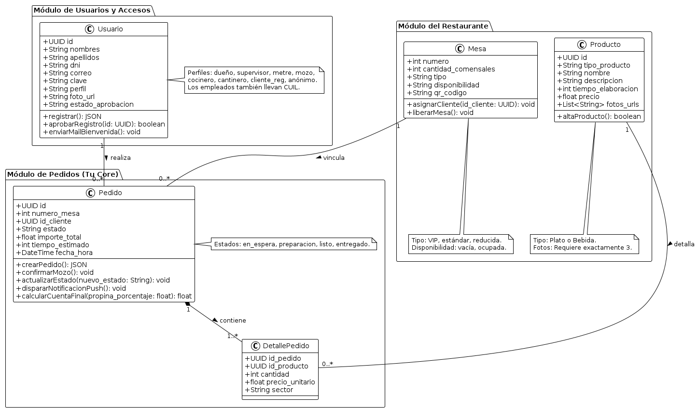
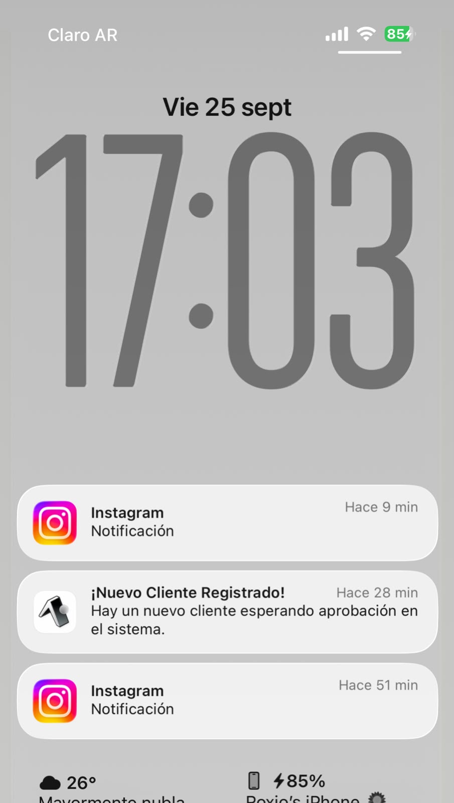
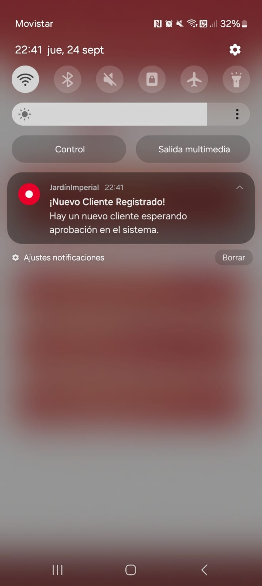
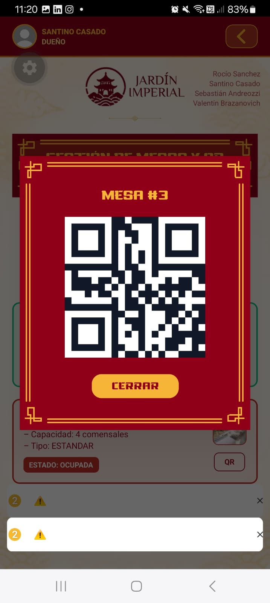

# Trabajo Final Integrador 2026 - Tecnicatura Universitaria en Programación (UTN)

<p align="center">
  
</p>

Repositorio oficial del grupo para el Trabajo Final Integrador (TFI). La aplicación móvil y la API acompañan la operación de un restaurante de comida china: gestión de usuarios, mesas y sala de espera, carta, pedidos, comandas, chat, juegos y notificaciones.

## 🎨 Identidad Visual

- **Temática:** restaurante de comida china.
- **Paleta principal:**
  - `#780116` — rojo oscuro.
  - `#F7B538` — amarillo.
  - `#DB7C26` — naranja suave.
  - `#D8572A` — naranja intenso.
  - `#C32F27` — rojo vibrante.

---

## 👥 Grupo y Responsabilidades

### 1. Brazanovich, Valentín

- **Rol:** Frontend Lead & UX/UI.
- **Objetivos:** autenticación, alta de empleados, registro de clientes y maquetación de la aplicación.
- **Fecha de inicio:** 25/08/2026.
- **Fecha estimada de cierre:** pendiente de confirmar con la cátedra.
- **Branch:** `feature/valentin-auth-ui`.

### 2. Andreozzi, Sebastián

- **Rol:** Frontend App Developer.
- **Objetivos:** pantallas de platos y bebidas, carta, interacción de cliente y funcionalidades de interfaz vinculadas con pedidos y juegos.
- **Fecha de inicio:** 25/08/2026.
- **Fecha estimada de cierre:** pendiente de confirmar con la cátedra.
- **Branch:** `feature/sebastian-menu-juegos`.

### 3. Casado, Santino

- **Rol:** Backend & Integration Engineer.
- **Objetivos:** autenticación, clientes, aprobación de usuarios, correos transaccionales con Nodemailer e integración transversal de notificaciones push mediante Expo API.
- **Fecha de inicio:** 25/08/2026.
- **Fecha estimada de cierre:** pendiente de confirmar con la cátedra.
- **Branch:** Integrada en `main` desde `feature/santino-server-setup`.

### 4. Sanchez, Rocío

- **Rol:** Database Admin, API Developer & QA.
- **Objetivos:** modelo de tablas, QR, mesas, políticas RLS y desarrollo de los módulos y endpoints de Pedidos y Chat en tiempo real.
- **Fecha de inicio:** 25/08/2026.
- **Fecha estimada de cierre:** pendiente de confirmar con la cátedra.
- **Branch:** `feature/rocio-supabase-db`.

> La fecha oficial de entrega no está consignada en el repositorio. Se deja pendiente de confirmación en vez de asumir una fecha de fines de septiembre u octubre.

---

## 🛠️ Tecnologías

- **Aplicación móvil:** React Native, Expo y TypeScript.
- **Estilos:** NativeWind.
- **API:** Node.js, Express y TypeScript.
- **Base de datos, autenticación y almacenamiento:** Supabase, PostgreSQL, Supabase Auth y Supabase Storage.
- **Validación de datos:** Zod.
- **Carga de archivos:** Multer.
- **Correo transaccional:** Nodemailer.
- **Notificaciones móviles:** Expo Notifications y Expo Push API.
- **Lectura de QR y cámara:** Expo Camera.

---

## 🏗️ Arquitectura

El frontend se organiza en pantallas, servicios de acceso a API y contextos de sesión y carrito. La navegación principal está coordinada desde `frontend/App.tsx`.

El backend separa rutas, controladores, servicios y esquemas por dominio:

- `auth`
- `cliente`
- `empleados`
- `productos`
- `mesas`
- `pedidos`
- `chat`
- `juegos`
- `encuesta` (el código existe, pero sus rutas todavía no están montadas en el servidor).

Supabase proporciona persistencia, autenticación y almacenamiento de archivos. Las políticas RLS deben revisarse junto con la autorización aplicada en los middleware del backend.



---

## 📋 Funcionalidades del Sistema

- Registro y administración de empleados.
- Registro, aprobación y rechazo de clientes.
- Registro de clientes anónimos y gestión de la sala de espera.
- Alta de mesas y generación de datos QR.
- Alta, consulta y baja lógica de productos.
- Consulta de carta, armado de carrito y seguimiento de pedidos.
- Gestión de comandas de mozo, cocina y bar.
- Chat entre clientes y personal del restaurante.
- Notificaciones push para eventos de clientes, pedidos, mesas y chat.
- Registro de jugadas y consulta de descuentos asociados a pedidos.
- **Punto 21 — Cierre de mesas:** simulación de pago estilo Mercado Pago, cálculo de propinas, aplicación de descuentos por juegos y liberación de mesa. Es una simulación; no procesa pagos reales y sus endpoints están pendientes de implementación.
- Encuestas y estadísticas: existe código backend parcial, pero la ruta todavía no está montada en el servidor.

---

## 🔔 Notificaciones Push

El backend envía notificaciones mediante Expo Push API. El frontend obtiene el token del dispositivo y lo registra en el backend. La aplicación recibe notificaciones, muestra un banner interno cuando está abierta y procesa la interacción para navegar al flujo correspondiente.

El equipo comprobó la visualización de notificaciones en iOS y Android:

| Plataforma | Evidencia                                                                     |
| ---------- | ----------------------------------------------------------------------------- |
| iOS        |          |
| Android    |  |

> Para probar push remoto en Android, usar un development build o una compilación independiente. La configuración actual desactiva las notificaciones push remotas en Expo Go para Android.

---

## ⚙️ Instalación y Configuración Local

### Requisitos

- Node.js y npm.
- Proyecto Supabase configurado.
- Expo Go o un development build / emulador compatible.
- Para un dispositivo físico, computadora y dispositivo conectados a la misma red local.
- Para probar push remoto, un dispositivo o build compatible y permisos de notificaciones habilitados.

### Backend

```bash
cd backend
npm install
npm run dev
```

Comandos adicionales:

```bash
npm run build
npm start
```

### Frontend

En otra terminal:

```bash
cd frontend
npm install
npm start
```

Comandos de Expo:

```bash
npm run android
npm run ios
npm run web
```

El frontend obtiene la IP local a partir del host de Expo para conectarse a la API. El backend utiliza el puerto `3000` por defecto.

### Variables de entorno

Crear `backend/.env`:

```env
PORT=3000
NODE_ENV=development
SUPABASE_URL=https://tu-proyecto.supabase.co
SUPABASE_ANON_KEY=tu_clave_anon
SUPABASE_SERVICE_ROLE_KEY=tu_clave_service_role
GMAIL_USER=correo@gmail.com
GMAIL_APP_PASSWORD=contraseña_de_aplicacion
```

Crear `frontend/.env`:

```env
EXPO_PUBLIC_SUPABASE_URL=https://tu-proyecto.supabase.co
EXPO_PUBLIC_SUPABASE_ANON_KEY=tu_clave_anon
```

En desarrollo, el frontend también admite opcionalmente `EXPO_PUBLIC_TEST_PUSH_TOKEN` para pruebas de notificaciones.

> No subir archivos `.env`, contraseñas ni claves reales al repositorio. `SUPABASE_SERVICE_ROLE_KEY` debe permanecer exclusivamente en el backend. No usar tokens de prueba como credenciales permanentes.

---

## 🔌 Endpoints del Backend

La API se ejecuta por defecto en `http://localhost:3000`.

### Sistema y autenticación

| Método | Ruta              | Autenticación | Descripción                                 |
| ------ | ----------------- | ------------- | ------------------------------------------- |
| `GET`  | `/`               | No            | Comprueba que la API esté activa.           |
| `GET`  | `/api/ping-db`    | No            | Comprueba la conexión con Supabase.         |
| `POST` | `/api/auth/login` | No            | Login del backend con `email` y `password`. |

El frontend inicia sesión directamente con Supabase y conserva un fallback local de demostración; no depende exclusivamente de `/api/auth/login`.

### Empleados y sala de espera

| Método | Ruta                       | Autenticación                                      | Datos principales                                                                                                    |
| ------ | -------------------------- | -------------------------------------------------- | -------------------------------------------------------------------------------------------------------------------- |
| `POST` | `/api/empleados/empleados` | Actualmente sin middleware JWT                     | `multipart/form-data`: `email`, `password`, `first_name`, `last_name`, `dni`, `cuil`, `role`, `rol_creador`, `foto`. |
| `GET`  | `/api/empleados/empleados` | Actualmente sin middleware JWT                     | Lista empleados.                                                                                                     |
| `GET`  | `/api/empleados/`          | Bearer JWT; roles `maitre`, `owner` o `supervisor` | Lista de espera.                                                                                                     |

### Clientes

| Método  | Ruta                       | Autenticación                            | Datos principales                                                                     |
| ------- | -------------------------- | ---------------------------------------- | ------------------------------------------------------------------------------------- |
| `POST`  | `/api/clientes/register`   | Sin middleware JWT                       | `multipart/form-data`: `email`, `password`, `first_name`, `last_name`, `dni`, `foto`. |
| `POST`  | `/api/clientes/anonymous`  | Sin middleware JWT                       | JSON con `client_name` y `client_photo`.                                              |
| `GET`   | `/api/clientes`            | Actualmente sin middleware JWT           | Lista clientes; admite filtro de estado.                                              |
| `PATCH` | `/api/clientes/:id/status` | Bearer JWT; roles `owner` o `supervisor` | JSON con `status`: `approved` o `rejected`.                                           |
| `PATCH` | `/api/clientes/push-token` | Bearer JWT                               | JSON con `push_token`.                                                                |
| `POST`  | `/api/clientes/ingresar`   | Actualmente sin middleware JWT           | Registra el ingreso a la lista de espera.                                             |

### Productos

| Método  | Ruta                      | Autenticación                                        | Datos principales                                                                                              |
| ------- | ------------------------- | ---------------------------------------------------- | -------------------------------------------------------------------------------------------------------------- |
| `POST`  | `/api/productos`          | Bearer JWT; permisos por categoría en el controlador | `multipart/form-data`: `name`, `description`, `prep_time`, `price`, `category` y hasta cinco archivos `fotos`. |
| `GET`   | `/api/productos`          | Bearer JWT                                           | Lista productos; admite `?category=`.                                                                          |
| `PATCH` | `/api/productos/:id/baja` | Bearer JWT                                           | Baja lógica del producto.                                                                                      |

Categorías utilizadas: `dish`, `drink` y `dessert`. La ruta `DELETE /api/productos/:id` existe para desarrollo y testing; no usar en producción.

### Mesas

| Método  | Ruta                    | Autenticación                                      | Datos principales                                                        |
| ------- | ----------------------- | -------------------------------------------------- | ------------------------------------------------------------------------ |
| `POST`  | `/api/mesas`            | Bearer JWT; roles `owner` o `supervisor`           | `multipart/form-data`: `table_number`, `capacity`, `table_type`, `foto`. |
| `GET`   | `/api/mesas`            | Bearer JWT                                         | Lista mesas.                                                             |
| `PATCH` | `/api/mesas/:id/estado` | Bearer JWT; roles `owner`, `supervisor` o `maitre` | JSON con `availability`.                                                 |

Tipos admitidos: `standard`, `vip`, `reduced_mobility`. Estados: `free`, `occupied`, `cleaning`.

Al crear una mesa, el backend genera `qr_data` con este patrón:

```text
RESTO-TFI-MESA-<numero>
```

### Pedidos

| Método  | Ruta                                | Autenticación                                                       | Datos principales                                                                                      |
| ------- | ----------------------------------- | ------------------------------------------------------------------- | ------------------------------------------------------------------------------------------------------ |
| `POST`  | `/api/pedidos`                      | Actualmente sin middleware JWT                                      | JSON con `id_cliente`, `numero_mesa`, `productos` (`id_producto`, `cantidad`) y `order_type` opcional. |
| `GET`   | `/api/pedidos/:id`                  | Actualmente sin middleware JWT                                      | Consulta estado, mesa, productos, importe y tiempo estimado.                                           |
| `PUT`   | `/api/pedidos/:id`                  | Actualmente sin middleware JWT                                      | JSON con `productos`; modifica un pedido rechazado.                                                    |
| `PUT`   | `/api/pedidos/:id/confirmar`        | Bearer JWT; roles `waiter`, `owner` o `supervisor`                  | JSON con `waiter_id`, `estado` (`in_preparation` o `cancelled`) y `rejection_reason` si se cancela.    |
| `GET`   | `/api/pedidos/cocina`               | Actualmente sin middleware JWT                                      | Lista pedidos pendientes de cocina.                                                                    |
| `GET`   | `/api/pedidos/bar`                  | Actualmente sin middleware JWT                                      | Lista pedidos pendientes de bar.                                                                       |
| `PATCH` | `/api/pedidos/items/:item_id/listo` | Bearer JWT; roles `cook`, `bartender`, `owner` o `supervisor`       | Marca un ítem como listo.                                                                              |
| `PATCH` | `/api/pedidos/:id/entregar`         | Bearer JWT; roles `waiter`, `owner` o `supervisor`                  | Marca el pedido como entregado.                                                                        |
| `PATCH` | `/api/pedidos/:id/recibir`          | Bearer JWT; roles actuales `registered_client` o `anonymous_client` | Confirma la recepción del pedido.                                                                      |
| `GET`   | `/api/pedidos/:id/cuenta`           | **Planificado:** Bearer JWT                                         | **Pendiente.** Detalle del ticket, propinas y descuentos.                                              |
| `PATCH` | `/api/pedidos/:id/pagar`            | **Planificado:** Bearer JWT                                         | **Pendiente.** Simula el pago y libera la mesa.                                                        |

`order_type` admite `dine_in` o `delivery`. Las rutas de cuenta y pago son contratos previstos para el Punto 21; no están disponibles hasta que se implementen. El flujo será una simulación estilo Mercado Pago, no una transacción real. Las rutas existentes sin middleware de autenticación deben revisarse antes de producción.

> ## ⚠️ Atención Frontend: los roles de la API se envían en inglés
>
> Los middlewares comparan el rol del usuario con los valores guardados en Supabase. No enviar etiquetas traducidas como `mozo` o `cocinero` al backend.
>
> Los roles encontrados en las rutas actuales incluyen `waiter`, `cook`, `bartender`, `maitre`, `owner`, `supervisor`, `registered_client` y `anonymous_client`. **En particular, `/api/pedidos/:id/recibir` exige actualmente `registered_client` y `anonymous_client`, no `client` y `anonymous`.** No usar esos alias hasta que el backend y los datos de Supabase se cambien coordinadamente.

### Chat

| Método | Ruta        | Autenticación | Datos principales                                                                                                       |
| ------ | ----------- | ------------- | ----------------------------------------------------------------------------------------------------------------------- |
| `POST` | `/api/chat` | Bearer JWT    | JSON con `message`, `table_id` opcional, `order_id` opcional y `chat_type` opcional. El remitente se toma de la sesión. |
| `GET`  | `/api/chat` | Bearer JWT    | Lista mensajes; admite `?table_id=<UUID>`.                                                                              |

`chat_type` admite `table_waiter` y `delivery_client`. Al enviar un mensaje, el backend puede notificar al destinatario mediante Expo Push API.

### Juegos

| Método | Ruta                           | Autenticación                  | Descripción                                          |
| ------ | ------------------------------ | ------------------------------ | ---------------------------------------------------- |
| `POST` | `/api/juegos/jugada`           | Actualmente sin middleware JWT | Registra una jugada y procesa la regla de descuento. |
| `GET`  | `/api/juegos/pedido/:order_id` | Actualmente sin middleware JWT | Consulta jugadas o descuentos asociados al pedido.   |

### Encuestas

Existe código de controladores, servicio y rutas para encuestas, pero el módulo no está montado en `backend/src/index.ts`. No hay endpoints de encuestas disponibles en la API hasta completar ese montaje.

---

## ⚠️ Integración y Limitaciones Conocidas

- El login del frontend usa Supabase directamente; también existe un fallback local de demostración.
- Algunas pantallas o servicios pueden conservar comportamientos simulados cuando falla el backend. Confirmar en cada prueba si el dato quedó persistido en Supabase.
- La app contiene pantallas de carta, carrito, sala de espera, comandas, tickets de cocina/bar y chat; quedan pruebas end-to-end con roles y datos reales.
- Las notificaciones push se envían desde el backend, se reciben en la aplicación y permiten mostrar un banner y navegar al flujo correspondiente. El equipo informa que la notificación del sistema se visualiza correctamente en iOS y Android.
- Hay una diferencia de nomenclatura de roles para clientes entre la instrucción funcional (`client`/`anonymous`) y las rutas actuales (`registered_client`/`anonymous_client`); el frontend debe seguir los valores aceptados por el código hasta que se actualice el contrato.
- El cierre de cuenta del Punto 21 y las rutas `/cuenta` y `/pagar` aún no están implementados.

---

## 📊 Estado de Funcionalidades

| Funcionalidad                      | Estado                    | Observación                                                                                        |
| ---------------------------------- | ------------------------- | -------------------------------------------------------------------------------------------------- |
| Login con Supabase                 | Implementado              | El frontend autentica directamente con Supabase.                                                   |
| Login por API                      | Implementado en backend   | Disponible en `/api/auth/login`; no es el flujo principal del frontend.                            |
| Empleados                          | Parcialmente integrado    | Hay alta, listado y consulta de espera; algunas rutas no exigen autenticación.                     |
| Registro y aprobación de clientes  | Implementado en backend   | Incluye aprobación/rechazo, correo y push si hay un token registrado.                              |
| Clientes anónimos y sala de espera | Implementado parcialmente | Hay endpoints y pantallas; validar el flujo completo de asignación, estados y salida.              |
| Productos y carta                  | Implementado parcialmente | Hay alta, listado, baja lógica y pantallas de carta; validar flujo completo por rol.               |
| Mesas y QR                         | Implementado              | El frontend envía el formato multipart esperado y utiliza los datos QR del backend.                |
| Pedidos y comandas                 | Implementado parcialmente | Hay endpoints y pantallas de carrito, estado, comandas y tickets. Cierre de cuenta/pago pendiente. |
| Chat                               | Implementado parcialmente | Hay endpoints autenticados, pantallas y push; debe probarse el flujo integral.                     |
| Push notifications                 | Implementado e integrado  | Expo Push API en clientes, pedidos y chat; el equipo confirma visualización en iOS y Android.      |
| Juegos y descuentos                | Implementado parcialmente | Hay endpoints en backend; cerrar y verificar la integración con la cuenta del pedido.              |
| Encuestas y estadísticas           | Pendiente de integración  | Hay código backend, pero las rutas no están montadas; la vista actual usa datos demostrativos.     |

---

## 📝 Tareas Pendientes

### Backend e integración — Santino

- [x] Integrar `feature/santino-server-setup` en `main` y alinear la comprobación de roles del middleware con los valores de Supabase.
- Desarrollar `GET /api/pedidos/:id/cuenta` para calcular y consultar el ticket, incluyendo propinas y descuentos.
- Desarrollar `PATCH /api/pedidos/:id/pagar` para simular el pago y liberar la mesa; no integrar cobros reales de Mercado Pago.
- Montar y verificar el módulo de encuestas en el enrutador principal como `/api/encuestas`.
- Revisar por separado las rutas que todavía no tienen middleware JWT, incluidas rutas de empleados, clientes, pedidos y juegos.

### Base de datos y módulos API — Rocío

- Aplicar o verificar la restricción `UNIQUE` de `table_number`.
- Definir, aplicar y documentar las policies RLS.
- Versionar las migraciones SQL.
- Revisar y proteger los endpoints de Pedidos y Chat según rol y propiedad de los recursos.
- Coordinar los datos entre lista de espera, mesas, pedidos y chat.

### Frontend — Valentín / Sebastián

- Completar pruebas end-to-end de registro, aprobación, ingreso a sala de espera, asignación de mesa, carta, pedido y chat.
- Verificar que errores de red no aparezcan como operaciones exitosas persistidas.
- Completar la navegación e integración de juegos y descuentos asociados a pedidos.
- Integrar la interfaz con los endpoints de cuenta y pago una vez implementados.
- Reemplazar los datos demostrativos de encuestas con información de un endpoint real si el módulo se incluye en la entrega.

### Calidad, seguridad y entrega

- Verificar rechazos de tokens inválidos, cuentas no aprobadas y roles sin autorización.
- Revisar CORS: actualmente se permite `origin: '*'`; restringirlo para producción.
- Crear o completar pruebas unitarias y de integración para rutas, permisos, estados y notificaciones.
- Agregar `backend/.env.example` y `frontend/.env.example` sin secretos.
- Confirmar con la cátedra la fecha oficial de entrega y actualizar el cronograma del equipo.
- Actualizar esta documentación si cambian contratos, nombres de campos o estados.

---

## 🧪 Evidencias y Pruebas

### Pruebas del backend

- [Validación de esquemas Zod](./assets/tests/PruebaValidacionZod.png)
- [Reglas de negocio y permisos](./assets/tests/PruebaReglasNegocio.png)
- [Flujo exitoso de creación](./assets/tests/FlujoExitosoCreacion.png)
- [Reporte de testing de la aplicación](./qa-test/reporte-testing.md)

> El reporte existente está fechado el 10/09/2026 y corresponde a una tablet Android con Expo Go; es evidencia histórica, no una validación completa de los cambios posteriores.

### Notificaciones push

| Plataforma | Evidencia                                                                     |
| ---------- | ----------------------------------------------------------------------------- |
| iOS        |          |
| Android    |  |

### Mockups

- [Login](./assets/makeup/logIn.png)
- [Registro](./assets/makeup/registro.png)
- [Inicio](./assets/makeup/viewInicio.png)
- [Bienvenida del pedido](./assets/makeup/bienvenidaPedido.png)

### QR de ingreso y mesas

| Uso                         | Imagen                                                                        |
| --------------------------- | ----------------------------------------------------------------------------- |
| Ingreso a la sala de espera |  |
| Mesa 1                      |                                   |
| Mesa 2                      |                                   |
| Mesa 3                      |                                   |
| Mesa 4                      |                                   |

El repositorio también contiene códigos QR para propinas (`qr_propina_0.PNG`, `qr_propina_5.PNG`, `qr_propina_10.PNG`, `qr_propina_15.PNG`, `qr_propina_20.PNG`).

---

_Repositorio mantenido por el grupo para la materia Trabajo Final Integrador._
